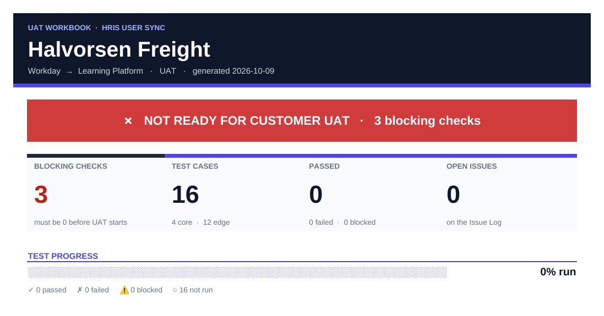
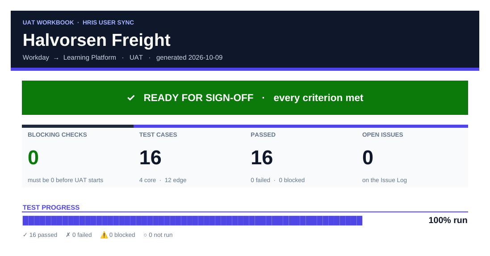
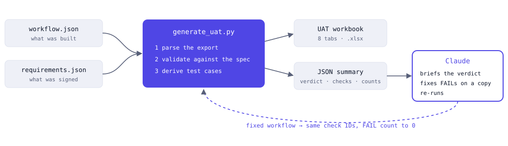
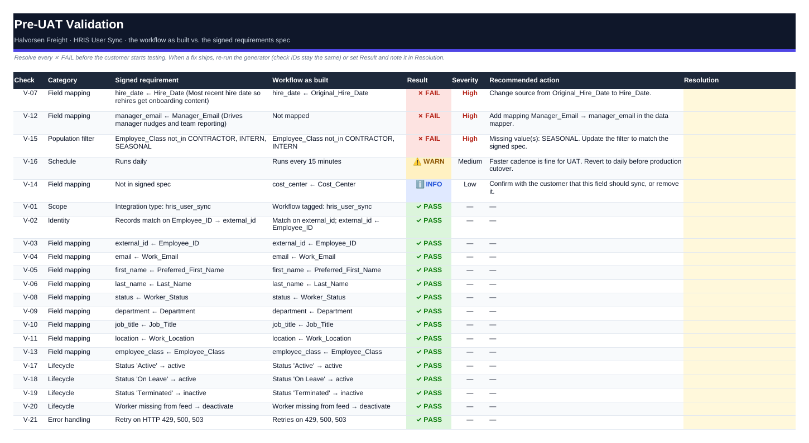
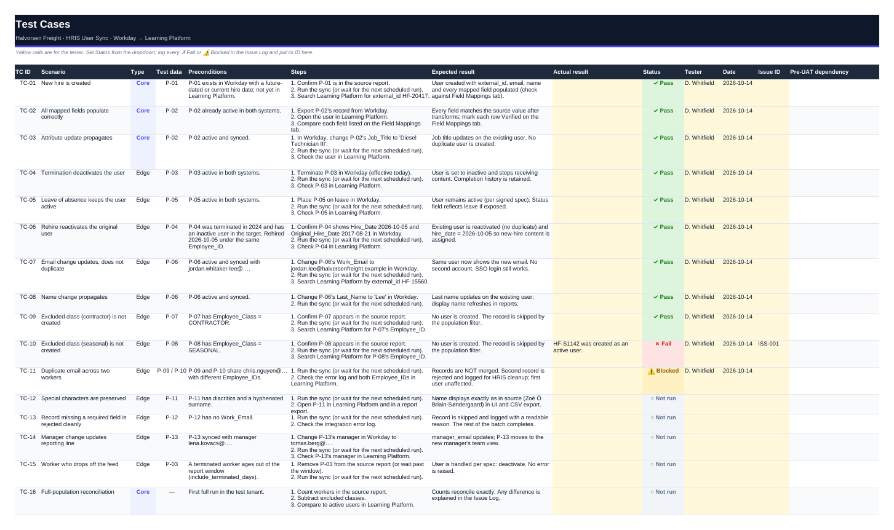

# UAT Script Generator

**A Claude skill that checks an integration build against the spec the customer signed, then generates the UAT workbook their HRIS team tests from.**

<p>
  
  
</p>

*The same workbook's Overview tab, as built (left) and after the fixes and a full test pass (right). Every number on it is a spreadsheet formula.*

**[Open the interactive walkthrough →](https://caseymullan.github.io/claude-skills/uat-script-generator/)**  ·  Sample workbooks in [`sample-output/`](sample-output/)

---

In enterprise HRIS and LMS integrations, the UAT script is the most-copied and least-trusted document in the project. Someone duplicates last customer's spreadsheet, edits the field names, forgets the edge cases that bit the last customer, and then the customer finds that the build doesn't match what they signed. This skill fixes both problems:

1. **Pre-UAT validation.** Every requirement in the signed spec is checked against what was built: field sources, the match key, population filters, lifecycle handling, schedule, time zones and retry coverage. Problems sort to the top with a plain-language fix, and check IDs stay the same between runs.
2. **Derived test cases.** They're generated from what the workflow does, not copied from the last customer. A workflow that maps hire date gets a rehire test. A population filter gets a test per excluded class. A timestamp conversion gets a late-evening time-zone test. A case that a known defect will break is flagged before the customer runs it.

I originally built the in-house version of this as a Solutions Engineer running Workday, SuccessFactors and Oracle HCM integrations. This repo is a from-scratch rebuild with **entirely fictional data**: Halvorsen Freight and every person in it are invented.

## How it runs



The script is deterministic: the same input gives the same workbook. Claude does the parts that need judgement: telling a person what each failure means for the customer, making the fix on a copy of the workflow, and running it again.

## What the demo catches

Both fictional Halvorsen Freight builds contain defects of the kind that actually come up in real projects:

| Check | Integration | Defect | What the customer would hit |
|---|---|---|---|
| ✗ V-07 | Workday → Learning Platform | `hire_date` mapped from `Original_Hire_Date` | Rehires keep their old date and never get onboarding |
| ✗ V-12 | | `manager_email` not mapped | Manager nudges and team reporting quietly fail |
| ✗ V-15 | | `SEASONAL` missing from the exclusion filter | Out-of-scope accounts on the first load |
| ⚠ V-16 | | Runs every 15 min; spec says daily | Fine for UAT; flagged so it's reverted before cutover |
| ℹ V-14 | | `cost_center` synced but not in the spec | A customer decision, not a silent fix |
| ✗ V-11 | Learning Platform → SuccessFactors LMS | Completion dates converted in UTC, not America/Chicago | Late-evening completions land on the next day |
| ✗ V-12 | | No retry on HTTP 429 | A bulk compliance load drops records at the rate limit |



## The workbook

Eight tabs, in `sample-output/`:

| Tab | What's on it |
|---|---|
| **Overview** | A live readiness banner (✗ Not ready → ▶ Ready for UAT → ✓ Ready for sign-off), KPI tiles, test-progress bar, workflow details |
| **Pre-UAT Validation** | Requirement against build: ✓ PASS / ✗ FAIL / ⚠ WARN / ℹ INFO, severity, recommended action, resolution |
| **Field Mappings** | Built source next to agreed source, transforms, sample value, flag with the check ID, and a Verified column for the customer |
| **Test Cases** | Core and edge cases with persona, steps, expected result, status dropdown, and the check each case depends on |
| **Test Data** | 13 fictional personas: new hire, rehire, leave, termination, duplicate email, diacritics… |
| **Issue Log** | An example row, plus severity and status dropdowns |
| **Sign-off** | Five criteria, all formulas, plus approver rows taken from the spec |
| **AI Instructions** | Rules for an agent maintaining the workbook across re-runs |



Every status carries an icon and a label, so nothing relies on color alone. Yellow cells are the customer's to fill in.

## Quick start

```bash
pip install openpyxl
python scripts/generate_uat.py \
  --workflow examples/halvorsen-freight/workday_user_sync.workflow.json \
  --spec     examples/halvorsen-freight/workday_user_sync.requirements.json \
  --out      outputs/UAT_Halvorsen_UserSync.xlsx
```

The script prints a JSON summary, so an agent can brief a person before they open the file:

```json
"verdict": "not ready",
"validation": { "PASS": 16, "FAIL": 3, "WARN": 1, "INFO": 1 },
"test_cases": { "total": 16, "core": 4, "edge": 12, "expected_to_fail_until_fixed": 4 }
```

Bad input gets a readable error and a non-zero exit code. Bad input includes invalid JSON, a missing file, an empty workflow, or an integration type the generator doesn't support.

### As a Claude skill
Add this folder as a skill. Then ask Claude *"Run the UAT demo"*, or attach your own export and say *"Generate UAT scripts for this workflow."* `SKILL.md` covers the rest: running the generator, briefing you on blockers in plain language, and the fix-and-rerun loop. `DEMO.md` is a five-minute talk track.

## Design choices

- **The spec is the source of truth.** A fix changes the workflow to match the spec, never the other way round. WARN and INFO items need a customer decision and are never fixed silently.
- **Deterministic tool, judgement in the agent.** The script produces the same output for the same input, so a customer-facing document is reviewable and auditable.
- **Formulas, not typed status.** The readiness banner, KPI tiles and sign-off criteria recalculate as testers fill in the sheet.
- **The platform adapter is separate.** The input is a small, documented shape (`references/input-formats.md`). Supporting a real Tray, Workato or Boomi export means writing an adapter; the checks don't change.

## Limitations

- Two integration types so far: HRIS user sync and LMS completions.
- The workflow format is a mock modeled on an iPaaS export, not a real vendor schema.
- Test personas are built in for each type rather than drawn from a customer's test tenant.
